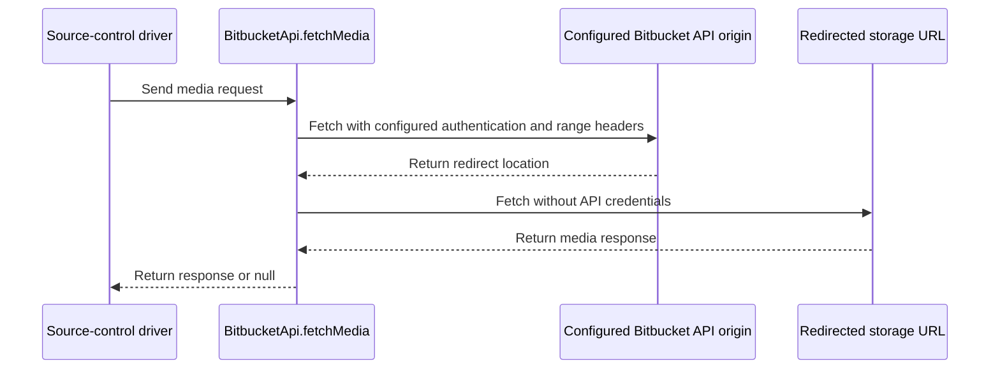

<a href="https://app.coderabbit.ai/change-stack/pingdotgg/t3code/pull/28596"><picture><source media="(prefers-color-scheme: dark)" srcset="https://storage.googleapis.com/coderabbit_public_assets/review-stack-in-coderabbit-ui-dark.svg?v=3"></picture></a>

No actionable comments were generated in the recent review.

<strong><picture></picture> Recent review info</strong>

<dl><dd>

<strong>Run configuration</strong>

- **Repository:** pingdotgg/t3code
- **Branch:** main

</dd></dl>

<strong>Merge Risk: 🟣 Minimal</strong> · up to <code>bb5d2</code>

The reviewed changes are ready to merge after normal checks.

### Sequence Diagram(s)

